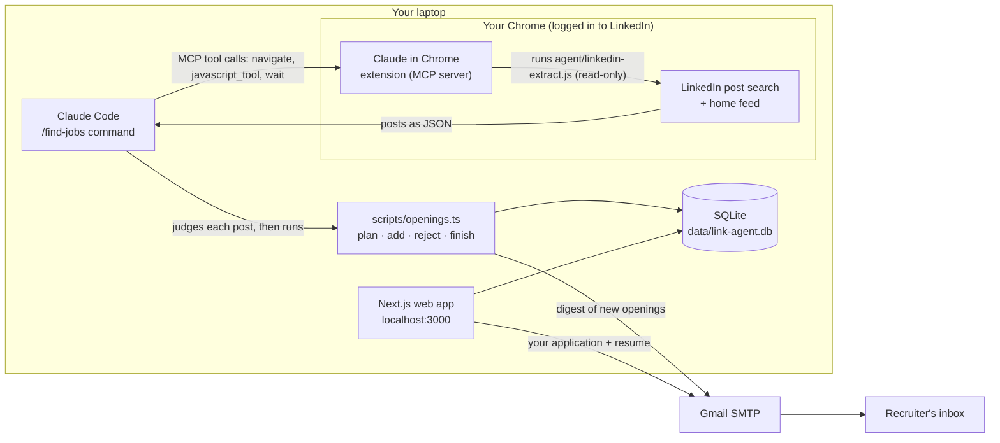

# Link Agent: architecture

Link Agent finds job openings in LinkedIn posts, keeps the ones that fit your profile and include an email, and lets you apply by email from your own Gmail. It runs entirely on your laptop and uses no paid API: the agent is Claude Code (part of your Claude Pro plan) reading LinkedIn in your own logged-in Chrome.

## How the pieces fit



**Starting a run:** click **Get jobs** in the web app, or type `/find-jobs` in Claude Code. The button calls `POST /api/get-jobs`, which starts a headless Claude Code session in the background (`claude -p "/find-jobs" --chrome`, restricted with `--allowedTools` to the browser steps and the `openings` script). The session uses your Claude Code login, so it runs on your Pro plan. The app follows the session's stream-json log in `data/runs/` to show progress, and refreshes when it ends.

**One run of `/find-jobs`:**

1. **Plan.** `npm run -s openings -- plan` returns the next 8 searches (role × city, continuing where the last run stopped), your skills, the experience limit, and the fingerprints of posts already seen.
2. **Read.** Claude opens each LinkedIn post search in a new tab of your Chrome through the Claude in Chrome MCP tools, waits a few seconds, and runs `agent/linkedin-extract.js` in the page. The script scrolls, expands "…more", and returns each post's text, poster and emails. It never clicks Like, Follow, Message or Apply.
3. **Judge.** Claude decides for each post: is it a real opening, for one of your roles, in Hyderabad or Mumbai, asking for at most 3 years, with an email? It extracts role, company, location, experience, skills and a summary.
4. **Save.** `openings add` validates each opening, checks the email really appears in the post, scores it against your roles, city and skills, and stores it. `openings reject` remembers posts that don't fit, so later runs skip them.
5. **Notify.** `openings finish` logs the run and emails you a digest of the new openings.
6. **Draft.** For each saved opening Claude also writes an application email tailored to that post: it follows the post's required subject line and questions, leads with the resume achievements that match the job, and leaves bracketed gaps such as `[notice period]` for facts your resume doesn't hold. `/draft-emails` does the same for openings without a draft (posts you paste, or after you change your resume).
7. **Apply.** In the web app you read the full post and review the tailored email. To change it, use the **Email assistant** under the message: one-click rewrites (Simplify, Elaborate, Shorter, More formal, Friendlier, Match the post) or chat ("lead with my edge deployment work"). It knows your resume, the post and the email, refuses to add claims your resume doesn't support, and every change can be undone. Edits save automatically. Fill any gaps and click **Send application**. The app won't send while a gap is left. It goes from your Gmail with your resume attached.

## Where MCP is used

MCP (Model Context Protocol) is how Claude Code gets tools from outside programs. A `/find-jobs` run uses two MCP servers:

| MCP server | What it gives Claude | Tools | Where it's defined |
|---|---|---|---|
| **Claude in Chrome** (the Chrome extension) | Your logged-in browser | `tabs_context_mcp`, `tabs_create_mcp`, `navigate`, `computer` (wait only), `javascript_tool` (runs the read-only extractor), `tabs_close_mcp` | Built into Claude Code (`--chrome`) |
| **link-agent** (this project) | Link Agent's database | `plan`, `add_openings`, `reject_posts`, `finish_run`, `openings_needing_drafts`, `save_drafts` | `scripts/mcp-server.ts`, registered in `.mcp.json` |

**Claude Code is the MCP client** in both cases: in your terminal (`/find-jobs`, `/draft-emails`) or in the background when you click **Get jobs**.

**Why a Link Agent MCP server:** openings, rejects and drafts go in as typed tool arguments, checked against a schema. Earlier versions passed JSON through shell commands, which a background Claude Code session isn't allowed to run, so its results couldn't be saved. With the MCP server the agent needs no shell access at all.

The tools each command may use are listed in its `allowed-tools`, and the background run is restricted to the same list (`src/lib/runner.ts`). `.claude/settings.json` pre-approves the link-agent server for this project.

Not MCP: the web app, email sending, and the email assistant (a separate, tool-free Claude Code call per request). There is **no LinkedIn MCP server**; community ones work by copying your login cookie, which is riskier for your account.

## Technology

| Layer | Technology | Where |
|---|---|---|
| Run trigger | "Get jobs" button → `/api/get-jobs` → headless `claude -p` session, progress read from its stream-json log | `src/lib/runner.ts`, `src/components/GetJobsButton.tsx` |
| Agent brain | Claude Code (Claude Pro plan) running project slash commands | `.claude/commands/find-jobs.md`, `.claude/commands/draft-emails.md` |
| Browser access | Claude in Chrome extension (MCP server) | your Chrome |
| Page reader | Plain JavaScript run in the LinkedIn tab | `agent/linkedin-extract.js` |
| Agent → database | Link Agent MCP server (stdio, `@modelcontextprotocol/sdk`), tool inputs validated with Zod; the same operations as a CLI for manual use | `scripts/mcp-server.ts`, `src/lib/bridge.ts`, `scripts/openings.ts` |
| Email assistant | Chat on each job page; every request is a headless, tool-free `claude -p` call with your resume text, the post and the current email, returning a revised email as structured JSON (`--json-schema`) | `src/lib/assistant.ts`, `src/app/api/assistant/route.ts`, `src/components/EmailAssistant.tsx` |
| Web app | Next.js 15 (App Router, Server Components, Server Actions), React 19, TypeScript 5 | `src/app/`, `src/components/` |
| Styling | Tailwind CSS v4 with design tokens taken from mobbin.com; Inter font; light and dark mode | `src/app/globals.css` |
| Database | SQLite through Node's built-in `node:sqlite` (Node 22.5+), WAL mode so the app and agent can share it | `src/lib/db.ts` → `data/link-agent.db` |
| Matching and rules | TypeScript: email extraction (including "name [at] company [dot] com"), role matching, skill matching, scoring | `src/lib/agent/` |
| Email | Nodemailer over Gmail SMTP (TLS, port 465) with a Gmail App Password | `src/lib/mail.ts`, `.env.local` |
| Tests | Node's built-in test runner via tsx (13 tests) | `src/lib/agent/agent.test.ts` |

Paid services: none. Claude usage comes out of your Pro plan's allowance.

## Data

| Table | Holds |
|---|---|
| `jobs` | Each saved opening: role, company, city, work mode, experience, skills, emails, the full post text, poster, score, status (new / saved / applied / ignored), and its tailored email draft |
| `rejected_posts` | Fingerprints of posts judged not a fit, with a short reason |
| `applications` | Every email you sent: to, subject, body, resume file, time, sent or failed |
| `runs` | One row per `/find-jobs` run: searches, posts judged, openings added |
| `kv` | Your settings (profile, skills, roles, cities, limits, email template) and the search rotation position |

A post's fingerprint is a hash of its longest lines, so the same post shared by a person and their company counts once. Your resume is stored in `data/resume/`. The whole `data/` folder and `.env.local` are git-ignored.

## Web app pages

| Page | Purpose |
|---|---|
| Openings `/` | Careers-page list grouped by role; search, filters (role, city, work mode, date, has email), sort by newest or best match |
| Job `/jobs/[id]` | Full post, matching skills, poster, links to the post; the Apply panel (template, resume, Send, or Open in Gmail) |
| Applications `/applications` | Everything you've sent |
| Add a post `/add` | Paste a post you found yourself |
| Settings `/settings` | Profile, resume, skills, roles, cities, limits, template, digest, email check |

## Folder map

```
link-agent/
├── .claude/commands/find-jobs.md   the agent's instructions (/find-jobs)
├── .claude/commands/draft-emails.md  how tailored emails are written (/draft-emails)
├── agent/linkedin-extract.js       read-only page reader run inside LinkedIn
├── scripts/mcp-server.ts           Link Agent MCP server (used by the agent)
├── scripts/openings.ts             the same operations as a CLI, for manual use
├── .mcp.json                       registers the MCP server for this project
├── src/
│   ├── app/                        Next.js pages and server actions
│   ├── components/                 UI components
│   └── lib/                        database, settings, jobs, mail, matching
├── docs/ARCHITECTURE.md            this document
├── data/                           database + resume (private)
└── .env.local                      Gmail address and App Password (private)
```

## Safety limits

- **LinkedIn:** read-only; at most 8 searches and 40 posts per run; pauses between pages; stops at once on any security check. LinkedIn's User Agreement forbids automated access, so some risk to the account remains.
- **Email:** nothing is sent to a recruiter without your click; at most 25 applications in any 24 hours; the app only sends to an address that appears in the post.
- **App access:** the web app listens on 127.0.0.1 only, so other devices on your network can't reach it; starting or stopping a run needs a header only the app's own button sends, so other websites can't trigger one.
- **Secrets:** the Gmail App Password lives only in `.env.local`, readable by your user account only.
